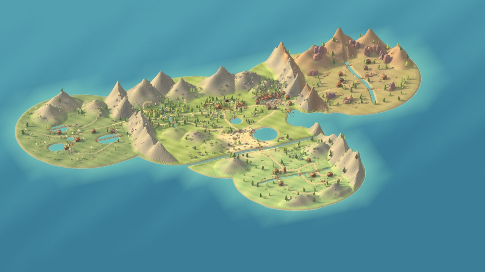

# Waldwinkel 1.14.0

Ein Cozy-3D-Spiel aus Bevy und Rust. Der Hof und sechs Ausflugsgebiete liegen in einer zusammenhängenden Landschaft. Wege und Brücken verbinden Farnwald, Muschelbucht, Eichenhafen, Kupferklamm, Windweiden und Nebelmoor. Der Tanuki, die neun Figuren und die 3D-Modelle stammen aus dem beigefügten Blender-Projekt.



## Installieren

- Lade die signierte APK im Browser herunter und öffne die Datei auf deinem Android-Gerät unter **Downloads**. [Android-APK 1.14.0](https://raw.githubusercontent.com/bthginfo/waldwinkel/4e3f2adac5c1d0a11f53548a33c6e9fe266092e4/Waldwinkel-1.14.0.apk) · [Alle Versionen](https://github.com/bthginfo/waldwinkel/releases)
- Voraussetzungen sind Android 8 oder neuer, Vulkan und ein 64-Bit-System (ARM64 oder x86-64). Das Spiel läuft offline. Installiere das Update über die bisherige Version, damit deine Spielstände erhalten bleiben.

## Zurück ins Hauptmenü

Drücke im Spiel die Xbox-Menü-Taste **☰** oder tippe oben rechts auf **Menü**. Wähle **Speichern & Hauptmenü** und bestätige am Controller mit **A**. In der Spielstandsauswahl kannst du deinen Hof mit **Fortsetzen** wieder öffnen. [Pausenmenü auf dem Tablet](docs/113-hauptmenue.jpg)

## Neu in 1.14.0

- **Spielstand löschen.** Wähle **Löschen** neben dem gewünschten Spielstand. Die Bestätigung zeigt Platz, Spieltag und Aufenthaltsort. Am Xbox-Controller ist **Abbrechen** vorausgewählt. Wechsle mit **→** zu **Endgültig löschen** und bestätige mit **A**. **B** bricht ab. Danach kannst du auf dem freien Platz neu beginnen oder eine exportierte Sicherung importieren.
- **Materialnachschub.** Fällbare Bäume, abbaubare Steine und Erzadern sind drei Spieltage nach dem Abbau wieder verfügbar. Schlafen lässt den nächsten Tag beginnen. Wildgras und wiederkehrende Sammelfunde kommen nach zwei Spieltagen zurück. Obst trägt nach zwei Spieltagen erneut und ruht im Winter. Für schweres Holz, Findlinge und kostbare Adern brauchst du Kupfer- oder Silberwerkzeuge und mehrere Schläge.
- **Hofküche.** Schneide die Zutaten je nach Gericht, halte die Glut beim Rühren im Zielbereich und schmecke das Gericht ab. Einmachgläser werden geschichtet und entlüftet. An der Handmühle hält regelmäßiges Kurbeln das Mahlwerk in Schwung. Saubere Arbeit kann eine zweite Portion bringen. Bei Controller-Nutzung stehen **X**, **A** und **Y** direkt an den Handgriffen.
- **Angeln.** Hake beim Biss an. Danach holst du in mehreren Zügen ein, wenn die Leine nachgibt. An der Seeseite brauchst du einen Zug mehr. Die farbige Anzeige zeigt, wann der Fisch die Leine straff zieht.
- **Ställe und Stationen aufstellen.** Öffne **Werkbank → Hof einrichten**, um einen gelernten Stallbauplan im Hofraster zu platzieren. Auch neue Schmiede- und Webstationen beginnen mit der Standortwahl. Bestätige mit **A** oder **Platzieren**. **X** oder **Drehen** dreht das Gebäude. Hühnerstall und Schafscheune werden nach einem bzw. zwei Spieltagen fertig. Beim Ausbau steigt die Kapazität von einem auf drei Tiere. Füttere sie täglich und sammle die Produkte am Stall ein. Hühner legen nach einem gefütterten Tag Eier, Schafe liefern nach zwei solchen Tagen Wolle und Milch.
- **Aufträge.** Der Tracker neben der Tablet-Minikarte zeigt die nächsten Ziele, Materialzahlen und abgabebereite Aufträge. Sobald die Zutaten für eine angenommene Lieferung vollständig sind, erscheint eine Meldung. In den Questdetails liest du die Geschichte hinter der Aufgabe. Mara, Fiete und Bo geben später Folgeaufträge für Küche, Schmiede und Tierhaltung.
- **Duelle.** Die Gegner in den Dämmergängen ziehen aus eigenen Decks. Sie wägen unter anderem Angriff, Deckung, Heilung und Aufladen gegeneinander ab. Du siehst die angekündigte Aktion, das Ausspielen der gegnerischen Karte und ihre Wirkung.
- **Marktweg.** Zwischen den Läden am Hof und den Holzstufen führt ein freier Durchgang durch den Zaun.

[Aufträge neben der Minikarte](docs/114-questtracker.jpg) · [Questdetails](docs/114-questdetails.jpg) · [Hofküche auf dem Tablet](docs/114-hofkueche.jpg) · [Spielstand löschen](docs/114-spielstand-loeschen.jpg) · [Gegnerdeck](docs/114-gegnerdeck.jpg)

## Neu in 1.13.0

- **Tablet mit Xbox-Controller.** Beim ersten Tastendruck wechseln die Touchflächen zu einer kompakten Tastenhilfe. Du siehst am Ziel, was **A** auslöst. Mit **X** öffnest du das Werkzeugrad, mit **LT** das Saatgut und mit **Y** die Karte. **↑** öffnet das Journal, **↓** die Tasche. Mit **←/→** wechselst du zwischen nahen Zielen, etwa zwischen Möbeln und Kartenbinder in der Hütte. **LB/RB** zoomen in der Welt und blättern in Listen mit mehreren Seiten. Im Kartenbinder und anderen Listen bleibt der Fokus beim seitlichen Blättern mit dem Steuerkreuz in derselben Reihe, auch wenn dazwischen Schaltflächen gesperrt sind. Beim Zurückgehen aus einem Untermenü landet er wieder an der vorherigen Stelle. Eine Berührung holt die Touchsteuerung zurück.
- **Dein erster Morgen.** Du kannst in Ruhe die erste Bewegungsaufgabe lesen. Erst nach deinen ersten Schritten läuft die Hofuhr weiter. Acht Abschnitte zeigen deinen Weg durch den Prolog. Sobald du Bo besuchen sollst, nennt dir die Aufgabe seinen aktuellen Aufenthaltsort.
- **Was dein Hof schon kann.** Öffne **Journal → Hofbuch**. Neben deinen fünf Meisterschaften siehst du Lebenspunkte, freie Talentpunkte, gesammelte Karten und Wohnräume. Wähle eine Meisterschaft für die Voraussetzungen und die nächste Belohnung. Über **Eichenhafens Dorfplatz → Dorfplatz zeigen** findest du das Gemeinschaftsprojekt.
- **Ein Garten für Eichenhafen.** Wähle am Dorftisch **Dorf ausbauen**. Lina errichtet Pflanzkisten, Bo setzt eine Kupferpumpe und Mara baut ein blühendes Laternenspalier. Zu jeder Lieferung siehst du, woher das Material kommt und wie viel noch fehlt. Auch kleine Beiträge bleiben gespeichert. Am fertigen Platz kannst du alle drei Spieltage einen Erntekorb für deinen Hof abholen.
- **19 illustrierte Kampfkarten.** Am heimischen Kartenbinder startet das Übungsduell. Beim Auswählen siehst du, was nach Rüstung und Schild ankommt. Die Vorschau berücksichtigt auch durchbrochene Deckung und tödliche Sporen. Karten werden einzeln ausgeteilt. Treffer, Deckung und Heilung haben eigene Effekte. Die neue Karte **Blütenwacht** erhältst du für den Dorfgarten. Sie schützt, heilt und lässt dich bei vorhandenem Schild eine Karte ziehen.

[Tablet mit Xbox-Steuerung](docs/113-tablet-hof.jpg) · [Karten auf dem 4:3-Tablet](docs/113-tablet-duell.jpg) · [Einstieg auf dem Hof](docs/113-prolog.jpg) · [Hofbuch](docs/113-hofbuch.jpg) · [Am Dorftisch](docs/113-ausbau.jpg) · [Der fertige Garten](docs/113-dorfgarten.jpg) · [Kartenkampf](docs/113-duell.jpg)

## Neu in 1.12.0

- **Eine Schale für den Hafen.** Fang am Hof oder am Fischersteg einen Fisch und schlaf in deiner Hütte. Am nächsten Morgen wartet Hafenmeister Bo an der Hofküche. Wähle **Mit Bo sprechen** im kleinen Menü an der Figur. Er bringt eine Möhre und sein Familienrezept mit. Wenn du deinen Fang schon verkauft hast, wartet Bo, bis du einen neuen mitbringst.
- **Mit Bo kochen.** Gib einen Fisch oder Hafenhering und eine Möhre in den Topf, rühre dreimal im grünen Bereich und schöpfe die Brühe ab. Drei Illustrationen begleiten die Handgriffe. Das Rezept bleibt in deiner Hofküche. In den Rezept- und Marktlisten erkennst du die Gerichte am selben Bild wie in der Tasche.
- **Abends in Eichenhafen.** Nach der ersten gemeinsamen Mahlzeit verkauft Bo am Brunnen täglich eine Schale für 18 Münzen, zwischen 18:00 und 21:30 Uhr. Kochst du nach Marktbeginn, startet er am nächsten Abend. Sein eigener Tisch kann schon vor Maras Markteröffnung stehen. Im Kartenkampf gibt eine Portion bis zu 6 Leben zurück und gewährt 4 Schild.

[Bo am Hof](docs/112-bo-am-hof.jpg) · [Gemeinsam kochen](docs/112-hafenbruehe-kochen.jpg) · [Suppenstand](docs/112-suppenstand.jpg) · [Angebot am Abendmarkt](docs/112-abendmarkt.jpg)

Auf einem älteren Hof mit Fisch oder Hafenhering im Vorrat reicht einmal Schlafen für den Besuch. Ist der Vorrat leer, startet der nächste Fang die Geschichte.

## Neu in 1.11.0

- **Eine Aktion direkt am Ziel.** Schau mit dem Tanuki zu einem Beet, zum Bett oder zu einer Figur. Das kleine Menü neben dem Objekt zeigt, was du tun kannst. Tippe auf die Aktion oder drücke die angezeigte Xbox-Taste. Auf Touchscreens kannst du ein sichtbares Objekt auch von weiter weg antippen.
- **Ein Beet bestellen.** Auf lockerer Erde öffnet **Saatgut** die Sortenauswahl. **Düngen** erscheint, wenn der Boden Dünger aufnehmen kann und du welchen dabeihast. Nach der Aussaat bietet ein trockenes Beet **Gießen** an. Bei Regen ist es bereits nass. Für einzelne Handgriffe merkt sich das Spiel dein ausgerüstetes Reihenwerkzeug.
- **Angeln am Steg.** Wirf aus und beobachte die Pose. Beim Biss hörst du Wasser. Neben **Einholen!** zeigt ein goldener Balken die verbleibende Zeit. Ein zu früher Tastendruck lässt die Angel im Wasser.
- **Übersicht.** Der Prolog erklärt die Aktionen am Beet. In der Einrichtung blendet das Spiel die Minikarte und die Sammelhinweise aus.

[Kontextmenü am Beet](docs/111-beetmenue.jpg) · [Xbox-Tasten am Beet auf Android](docs/111-xbox-kontext.jpg) · [Biss am Angelsteg](docs/111-angelsteg.jpg)

## Neu in 1.10.2

- Ein einzelner Zielrahmen markiert das gewählte Objekt. Beim Versetzen eines Möbels oder Hofgebäudes zeigt das Raster dessen aktuelle Vorschau. Android synchronisiert die Bildausgabe mit dem Bildschirm.
- Der Tanuki schaut auch bei Kontakt mit einem Hindernis in die Richtung deiner Eingabe. Das Bett lässt sich von der Vorderseite und von der Seite direkt benutzen.

## Neu in 1.10.1

- Im Werkzeug- und Saatgutrad bleibt die Markierung stehen, sobald du das Steuerkreuz oder den Stick loslässt. Der Stick zeigt direkt auf den passenden Sektor.

## Neu in 1.10.0

- **Xbox-Steuerung.** **A** benutzt das passende Ziel direkt vor dem Tanuki. **X** öffnet das Werkzeugrad, **LT** das Saatgut oder die Einrichtung im Haus. Werkzeuge, Samen und Mengen stehen direkt im Rad. Die Tastenhinweise wechseln passend zur Welt, zu Menüs und zum Duell.
- **Hof und Haus.** Möbel und gebaute Hofstationen lassen sich in Draufsicht im Raster verschieben und drehen. Die Beete bleiben beim Platzieren frei. Nach der Reparatur des Fischerstegs kannst du sechs weitere Beete anlegen.
- **Werkzeuge und Tiere.** Für die stärkeren Bäume und Erzadern brauchst du Kupfer- oder Silberwerkzeuge. Wildgras wächst an Sammelstellen nach und eignet sich als Futter. Gefütterte Hühner legen Eier, gefütterte Schafe geben Wolle und Schafmilch.
- **Karte und Sammeln.** Auf der Inselkarte siehst du das ungefähre Gebiet deines Auftrags. Auf größeren Bildschirmen zeigt die Minikarte die Richtung. Ein leichtes Glitzern markiert nahe Bäume, Steine und Funde, die du gerade abbauen oder sammeln kannst.
- **Handel und Handwerk.** Die Marktauslage zeigt Waren und Preise als bebilderte Karten. Du kannst Einzelstücke oder ganze Stapel verkaufen. Für Möbel und Hofgebäude zeigen die Menüs Vorschaubilder der Blender-Modelle.
- **Duell und Rückmeldung.** Die Karten haben neue Rahmen und Illustrationen. Im Übungsduell lernst du Schild, Angriff und Zugwechsel. Schlafen zeigt Tagwechsel, Ernte und Speicherstatus. Kauf, Verkauf und Aufträge bestätigen den Erfolg direkt im Spiel.

[Werkzeugrad mit Xbox-Hinweisen](docs/110-xbox.jpg) · [Saatgutrad](docs/110-saatgut.jpg) · [Einrichten im Raster](docs/110-einrichten.jpg) · [Auftragsgebiet](docs/110-auftragsgebiet.jpg) · [Kaufen](docs/110-markt.jpg) · [Verkaufen](docs/110-verkaufen.jpg) · [Übungsduell](docs/110-duell.jpg) · [Gespeichert nach dem Schlafen](docs/110-schlafen.jpg)

## Neu in 1.9.2

- Die Wegsuche verteilt längere Routen über mehrere Bilder. Währenddessen zeigt das Spiel „Weg wird gesucht“. Am Xbox-Controller bricht **B** ab.

## Neu in 1.9.1

- Die Inselkarte zeigt am Controller den Namen des gewählten Ziels und die Tasten zum Durchblättern, Hinlaufen und Zurückgehen.

## Neu in 1.9.0

- **Spielbarer Prolog.** Ein neuer Spielstand beginnt mit der Ankunft auf dem Hof. Der Prolog zeigt das jeweilige Ziel im Spiel und prüft den Handgriff. Du bestellst ein Beet, fällst einen Baum, baust Stein ab, reparierst die Werkbank, erntest, kochst und spielst ein Übungsduell. Danach zeigt dir die Inselkarte den Weg zu Bo und zur Hauptgeschichte.
- **Hofbuch.** Unter **Journal → Hofbuch** findest du je drei Ränge für Gartenbau, Werkstatt, Hofküche, Inselkunde und Duellkunst. Neben Belohnungen bringen die Ränge häufiger Saatgut, eine zusätzliche Portion bei sauberer Zubereitung oder mehr Bretter pro Charge.
- **Beetplanung.** Kürbisse mit großen Blättern halten in den Nachbarbeeten die Feuchtigkeit. Sonnenblumen können die Qualität benachbarter Tomaten und Erdbeeren verbessern. Diese zwei Kulturen tragen nach der Ernte erneut.
- **Hofküche.** Zutaten schneiden, im richtigen Moment rühren und abschöpfen. Beim Einmachen zählt die Zutatenfolge und der Moment zum Verschließen. Beim Mahlen kurbelst du abwechselnd links und rechts. Einzelne Schritte haben eigene Geräusche und sichtbare Rückmeldungen.
- **Kartenkampf.** Alle 18 Karten haben eigene Illustrationen. Beim Spielen fliegt die Karte aus der Hand. Gegner reagieren auf Treffer, und Werte und Klänge zeigen an, was gerade passiert. Mit „Spuren lesen“ bereitest du einen stärkeren Treffer vor. „Samenwurf“ verstärkt aktive Sporen.
- **Xbox-Steuerung.** Das Steuerkreuz markiert Orte und Figuren auf der Karte. A startet die Route. B geht in Untermenüs eine Ebene zurück und behält die Auswahl. Der Menüfokus überspringt ausgegraute Aktionen. Mit LB und RB blätterst du in längeren Listen.
- **Insel und Innenräume.** Wald, Strand, Stadt, Klamm, Weiden, Moor und Hof haben örtliche Pflanzen, Gesteine und Wegränder. Holz, Gewebe, Erde und Metall haben eigene Oberflächen. In der Hütte, der Mine und den Dämmergängen setzen Laternen und Kristalle Lichtakzente.

### Spielaufnahmen

[Inselübersicht](docs/190-insel.jpg) · [Hof](docs/190-hof.jpg) · [Farnwald](docs/190-farnwald.jpg) · [Muschelbucht](docs/190-muschelbucht.jpg) · [Eichenhafen](docs/190-eichenhafen.jpg) · [Kupferklamm](docs/190-kupferklamm.jpg) · [Windweiden](docs/190-windweiden.jpg) · [Nebelmoor](docs/190-nebelmoor.jpg)

[Holzhütte](docs/190-holzhuette.jpg) · [Mine](docs/190-mine.jpg) · [Dämmergänge](docs/190-daemmergaenge.jpg) · [Prolog](docs/190-prolog.jpg) · [Hofküche](docs/190-kochen.jpg) · [Kartenkampf](docs/190-kartenkampf.jpg)

## Neu in 1.8.0

- **Tanuki und neun Bewohner.** Die Blender-Modelle haben überarbeitete Gesichter, Blinzeln und eigene Kleidung. Der Tanuki trägt einen geflochtenen Hutrand, ein Halstuch und eine Latzhose. Am Markt erkennt man Mara an ihrer Brille und Schürze und Bo an seiner Hafenmütze.
- **Licht auf bewegten Figuren.** Gesichter und Kleidung bleiben auch beim Drehen gut zu lesen. Das Figurenlicht reagiert auf Tageszeit, Wetter und Deckung durch Dächer oder Baumkronen.
- **Perspektive und Hanglandschaft.** Die Außenkamera wechselt beim Zoomen sanft den Abstand und Blickwinkel. Nördlich von Eichenhafen staffeln sich bepflanzte Kalksteinbänder und bewaldete Hänge hinter den Dächern. Dunst trennt nahe und entfernte Landschaftsebenen.

[Tanuki in Nahansicht](docs/180-tanuki.jpg) · [Bewohner am Markt](docs/180-bewohner.jpg) · [Eichenhafen und die Nordhänge](docs/180-eichenhafen.jpg) · [Kalksteinhänge](docs/180-nordhang.jpg)

## Neu in 1.7.0

- **Licht und Atmosphäre.** Seitliches Sonnenlicht, weichere Bodenschatten und blaues Himmelslicht geben Geländen und Fassaden mehr Tiefe. Tageszeit, Jahreszeit und Wetter verändern die Beleuchtung der 3D-Szene. Am Abend erscheinen warme Fenster und Lichtkreise auf dem Pflaster.
- **Eichenhafen.** Steinbögen, Kalkputz, unregelmäßige Pflastersteine, Kletterpflanzen und verzweigte Bäume prägen den Marktplatz und seine Nebenstraßen. Die Kamera zeigt mehr von den Fassaden und folgt der Höhe des Geländes.
- **Hof und Küste.** Holzmaserung, ein gemauerter Sockel, bepflanzte Steinränder und Details am Tanuki ergänzen den Hof. Am Fischersteg wachsen Strandhafer und Küstenblumen zwischen geschichteten Uferfelsen. Tidenwasser, Farnbach, Teich und Brunnen haben animierte Lichtreflexe.

[Marktplatz in 1.6.0](docs/170-eichenhafen-vorher.jpg) · [Marktplatz in 1.7.0](docs/170-eichenhafen.jpg) · [Abendlicht](docs/170-abendlicht.jpg) · [Hof](docs/170-hof.jpg) · [Küste](docs/170-kueste.jpg)

## Neu in 1.6.0

- **Reihenarbeit.** Tippe am Hof auf **Werkzeug** oder drücke **R** auf der Tastatur beziehungsweise **R3** am Controller, um Hacke, Saatgut, Gießkanne oder Erntekorb auszuwählen. Die Markierungen zeigen den nächsten Schwung und das Folgebeet. Kupferwerkzeuge bearbeiten bis zu zwei passende Beete, Silberwerkzeuge bis zu drei.
- **Baupläne und Stellprobe.** Hefte Möbel, Bauprojekte, Werkzeugstufen oder Werkstoffe an. Unter **Journal → Aufträge** findest du fehlende Zutaten und ihre Fundorte. Die Karte zeigt ein passendes Ziel. Mit **Im Haus ansehen** kannst du vor dem Bau durch die Stellplätze wechseln und ein Möbel in deinem aktuellen Grundriss ausprobieren.
- **Maras Abendmarkt.** Nach Maras Küchenauftrag hilfst du ihr mit Brettern, Stein und einer ersten Kostprobe. Lina und Miro machen sich vor der Eröffnung mit ihr auf den Weg zum Stand. Nach der Quest kannst du täglich von 18:00 bis 21:30 Uhr vier Gerichte mit jeweils einem Stück Tagesvorrat kaufen.
- **Proviant im Duell.** Jede Mahlzeit hat eine Grundwirkung und ist gegen bestimmte Hüter besonders hilfreich. Marmelade verstärkt den Schild gegen Nebelgegner. Tomateneintopf hilft beim nächsten Treffer gegen die Rüstung der Tonwächter. Vor einer Wacht und im Proviantmenü steht, welches Gericht zum Gegner passt.
- **Eichenhafen und Bewohner.** Neue Giebel, Walmdächer, Schornsteine und der offene Glockenturm unterscheiden die Häuser. Am Abend leuchten die Laternen auf dem Pflaster. An ihren Stationen arbeiten die Bewohner mit Kochlöffel, Gießkanne, Päckchen, Notizbuch oder Hammer.

[Abendmarkt](docs/160-abendmarkt.jpg) · [Reihenarbeit](docs/160-beete.jpg) · [Möbelvorschau](docs/160-moebel.jpg)

## Neu in 1.5.1

- **Steuerung.** Der Tanuki läuft feinfühliger bei kleinem Stickweg, bremst schneller und reagiert direkter auf Richtungswechsel. Die Kamera folgt gleichmäßiger. Ecken am Boden markieren das gewählte Ziel. Bei dicht stehenden Objekten entscheidet die sichtbare Tiefe.
- **Aufträge und Bewohner.** Ein gelbes **!** zeigt einen neuen Auftrag. Ein grünes **?** zeigt, dass du einen Auftrag abgeben kannst. Die Zeichen stehen über den Figuren und neben ihrem Namen auf der Karte. Tippe auf einen Namen, um dorthin zu laufen. Die Karte zeigt die aktuellen Standorte aller Bewohner erreichbarer Gebiete.
- **Tagesabläufe.** Lina kümmert sich um die Pflanzkübel, Miro geht zum Hafentor und Juna sieht am Brunnen nach den Wegzeichen. Auch die Bewohner der Außenregionen wechseln den Ort. Unter **Journal → Dorf** steht, wo sie gerade sind.
- **Eichenhafen.** Markttücher, Ladenzeichen, bepflanzte Wegkanten und stärker abgestufte Schatten prägen den Platz. Vögel, Schmetterlinge und Käfer tauchen bei passendem Wetter auf. In warmen Nächten sind Glühwürmchen zu sehen.
- **Ton.** Klavier und Harfe reagieren auf Ort, Tageszeit und Gespräche. Beim Fällen hörst du Axtschlag, Splittern und Aufprall. Beete, Fertigung und Kampftalente haben eigene Rückmeldungen. Im Pausenmenü wechselt **Ton** zwischen **Ein**, **Ohne Musik** und **Aus**. [Aufnahmen und Audiodesign](docs/audio.md)

[Eichenhafen im Spiel](docs/151-eichenhafen.jpg) · [Bewohner und Aufträge auf der Karte](docs/151-karte.jpg) · [Baumfällen mit Spielton](https://github.com/bthginfo/waldwinkel/releases/download/v1.5.1/Waldwinkel-Baumfaellen.mp4)

## Neu in 1.5

- **Eine Kampagne bis zum Lichtfest.** Das Journal zeigt Kapitel, nächstes Ziel und fehlende Materialien. Nach dem ersten Beet schickt Bo dich mit Baumaterial zur Farnwacht. Fischersteg, regionale Wachten und Klangsteine führen anschließend bis zur Hafenleuchte. Die 25 Dämmer-Ebenen sind als Expedition neben der Kampagne spielbar.
- **Kampfstile.** Der erste Wachtsieg schaltet am Kartenbinder Rindenwacht, Windspur und Herdfeuer frei. Schutz und Konter, kurze Kartenfolgen und Proviant eröffnen verschiedene Spielweisen. Die ersten Duelle der drei bewachten Wachten haben eigene Angriffsfolgen.
- **Wiederaufbau.** Vollendete Wachten öffnen regionale Wegglocken. Bo geht nach der Wiedereröffnung regelmäßig bis ans Ende des Fischerstegs. Das Dach der Farnwacht, die Hofveranda und das Modell der Hafenleuchte wurden in Blender überarbeitet. Eigene Klangkulissen erklingen am Hof, im Farnwald und am geöffneten Hafen.
- **Sicherungen auf Android.** Öffne im Pausenmenü **Spielstand exportieren**, um eine Datei über die Android-Dateiauswahl zu speichern. Im Hauptmenü kannst du sie mit **Spielstand importieren** in einen freien Platz laden. Bei einer unlesbaren Hauptdatei erscheint **Wiederherstellen**, sobald eine gültige lokale Sicherung verfügbar ist.
- **Android 16.** Der Build zielt auf API 36. Der Randabstand des HUD berücksichtigt Displayausschnitte. Wenn Android einen Controller als getrennt meldet, werden gehaltene Tasten und Stickpositionen zurückgesetzt.

[Hof auf Android 16](docs/15-hof.jpg) · [Kapitel und Journal](docs/15-kampagne.jpg) · [Farnwacht](docs/15-farnwacht.jpg) · [Lichtfest](docs/15-lichtfest.jpg) · [Xbox-Menüfokus](docs/15-xbox.jpg) · [Importierte Sicherung](docs/15-sicherung.jpg)

## Neu in 1.4

- **Die fünf Wegwachten.** Öffne im Journal den Reiter **Wegwachten** oder frag Bo. Beginne in der Farnwacht. Folge den Wegzeichen, fertige Material und wecke die Lichter in Farnwald, Muschelbucht, Kupferklamm, Windweiden und Nebelmoor. Bring die fünf Geschichten zu Juna.
- **Wachtprüfungen.** Die Farnwacht bietet schon früh ein Kartenduell. Drei Wachten haben je vier ansteigende Prüfungen mit eigenen Regeln und Belohnungen. In einem Kampf kannst du einmal ein vorbereitetes Gericht einsetzen.
- **Hafenaufträge.** Am Auftragsbrett kannst du unter anderem Ernten, Fischen und Erzabbau als Auftrag annehmen. Aushänge wechseln alle drei Tage. Ein angenommener Auftrag bleibt bis zum Einlösen oder Aufgeben aktiv.
- **Fertigung.** Werkbank, Schmiedetisch und der neue Webrahmen stellen Fichtenbretter, Muschelglas, Kupfernieten, Segeltuch und Laternenöl her. Wähle ein, drei oder fünf Arbeitsgänge. Neue Rezepte lernst du an den Wegzeichen.
- **Xbox auf dem Tablet.** Linker Stick bewegt die Figur. Links und rechts am Steuerkreuz wählen nahe Ziele. **A** bestätigt. **X** benutzt das gewählte Ziel oder greift direkt auf das passende Ziel in der Nähe zu. **B** geht zurück. **Y** öffnet die Karte oder beendet im Duell den Zug.

[Stand und Qualitätsprüfung](docs/stand-1.4.md) · [Farnwacht](docs/14-farnwacht.jpg) · [Weitere Wegwachten](docs/14-wegwachten.jpg) · [Fertigung](docs/14-materialien.jpg) · [Proviant im Duell](docs/14-proviant.jpg) · [Szenenausschnitt mit Juna](docs/14-finale.jpg) · [Xbox-Fokus im Tabletformat](docs/14-xbox.jpg) · [Bildreferenz](art/references/wegwachten.jpg)

## Seit 1.3

- **Eine zusammenhängende Insel.** Bergkämme rahmen Farnwald, Hof und Kupferklamm. Die Wege ins Nebelmoor und in die Klamm führen durch Pässe, die Windweiden sind über die neue Weidebrücke erreichbar. Felsgruppen und Wälder markieren die Übergänge.
- **Dein erster Morgen.** Ein neuer Spielstand beginnt mit einer kurzen Kamerafahrt und Untertiteln. Danach führt dein erster Auftrag vom Hacken, Säen und Gießen bis zum Gespräch mit Bo. Über **Überspringen** kommst du direkt zum Auftrag.
- **Der alte Fischersteg.** Sprich mit Bo oder lies den Aushang am Bautisch in Eichenhafen. Treibholz vom Hafenufer und zwei Holz genügen für den ersten Anleger. Danach stellst du Kupferbeschläge an der Werkbank her und bringst Baumaterial und etwas aus deiner Ernte. Zur Wiedereröffnung gibt es eine zweite Kamerafahrt, den Zugang zur Seeseite mit Hafenheringen und den Bauplan für die Hafenlaterne.
- **Dorf.** Bo und Fiete laufen zwischen Rathaus, Markt und Hafen. Unter **Journal → Dorf** siehst du ihren aktuellen Aufenthaltsort und kannst ihn auf der Karte markieren. Gespräche ändern sich mit den Jahreszeiten und dem Ausbau des Stegs.
- **Tasche.** Gegenstände, Material, Saatgut und Ernte erscheinen mit eigenen Illustrationen und Stückzahl. Im Garten lassen sich die sichtbaren Blätter antippen, um das dazugehörige Beet zu wählen.
- **Wege und Ton.** Die Figur bremst am Ziel ab und rundet freie Kurven. Wenn die Materialien und Stadtaufträge bereit sind, öffnet die Aktion das Tor und führt dich hindurch. Am Wasser hörst du Wellen, bei Regen leises Trommeln auf Holz. Schritte klingen auf Dielen, Gras und Schnee unterschiedlich. Unter **Menü → Ton** lässt sich die Ausgabe umschalten.
- **Abbau.** Zusätzlich zu den Rohstoffbäumen am Hof kannst du 487 Wildbäume fällen und 172 weitere Findlinge abbauen. Beim Axtschlag fliegen Späne, und der Baum kippt. Felsen und Erzadern brechen beim Spitzhackenschlag in Stücke. Gefällte Bäume wachsen nach drei Spieltagen nach.
- **Hofwerkbank und Baupläne.** Setze die Werkbank vor der Hütte mit zwei Holz und einem Stein instand. Damit lernst du die ersten drei Möbelbaupläne. Weitere Pläne kaufst du bei Bo oder am Bauplanstand, findest sie unterwegs oder verdienst sie mit Aufträgen.
- **Werkzeugstufen.** Axt, Spitzhacke, Hacke und Gießkanne lassen sich auf Kupfer und Silber verbessern. Baue für Silber den Schmiedetisch. Axt und Spitzhacke erhöhen die Ausbeute. Hacke und Gießkanne gewinnen Reichweite.
- **Haus und Tierhaltung.** Die Baupläne der Gartenstube und Lesekammer öffnen zwei begehbare Anbauten. Pro Raum kommen vier Möbelplätze dazu. Kaufe für den Hühnerstall oder die Schafscheune zuerst den Bauplan und baue das Gebäude auf dem Hof. Bei einem bestehenden Spielstand ist die Hofwerkbank bereits instand gesetzt.

[Einführung](docs/13-ankunft.jpg) · [Tasche auf dem Handy](docs/13-tasche.jpg) · [Tasche auf dem Tablet](docs/13-tablet.jpg) · [Fischersteg](docs/13-steg.jpg) · [Wiedereröffnung](docs/13-eroeffnung.jpg) · [Baumfällen im Spiel](docs/13-abbau.mp4) · [Werkzeugausbau](docs/13-werkbank.jpg) · [Haus mit zwei Anbauten](docs/13-haus.jpg)

## Seit 1.2

- **Vier Jahreszeiten.** Alle sieben Spieltage wechseln Laubbäume und Wiesen ihr Aussehen. Im Winter tragen Nadelbäume und Dächer Schnee. Die Obstwiese ruht bis zum Frühling. Gegossene Gartenbeete wachsen weiterhin.
- **Kalender und Sammeln.** Unter **Journal → Kalender** findest du den nächsten Wechsel, Hinweise zu zwölf saisonalen Fundorten und deine Sammlung. Blütenzweige, Sonnenmuscheln, Bernsteinnüsse und Frostbeeren kannst du am Dorftisch abgeben oder verkaufen. Ein abgeernteter Fundort füllt sich nach zwei Tagen derselben Jahreszeit wieder.
- **Dorftisch in Eichenhafen.** Blütentausch, Sommertafel, Laublichter und Frostfrühstück finden jeweils an Tag 5–7 der Jahreszeit von 06 bis 20 Uhr statt. Zwei passende Funde bringen pro Treffen 18 Münzen und drei Samen. Für alle vier Treffen erhältst du den Bauplan fürs Jahreszeitenregal.
- **Licht und Wetter.** Abends gehen die Fenster und Lichter am Hof und in der Stadt an. Nebel hängt in der Ferne, Regen dunkelt Wiesen ab und trifft mit kleinen Ringen auf den Boden. Böen bewegen Wolken, Niederschlag und die Mühle.
- **Bewegung.** Der Tanuki beschleunigt und bremst schneller. Beim Anlaufen gleitet er an Ecken entlang. Figuren und der Dorftisch sind feste Hindernisse.

[Kalender](docs/12-kalender.jpg) · [Blütentausch](docs/12-dorftisch.jpg) · [Schneefall](docs/12-schnee.jpg) · [Nacht am Hof](docs/12-nacht.jpg)

## Seit 1.1

- **Das Licht der Wegglocken.** Sprich mit Juna in Eichenhafen, stimme die drei Klangsteine in Klamm, Weide und Moor und entzünde nach der letzten Dämmerglocke die Hafenleuchte.
- **Wege mit eigenen Orten.** Ein Erzgleis und Werkplätze in der Kupferklamm, Flachsfelder und ein drehendes Mühlrad auf den Windweiden, Weiden und Seerosen im Nebelmoor. Die Landschaftsmodelle sind in sichtbare Bereiche unterteilt.
- **Journal und Bedienung.** Das Journal zeigt Geschichte und Aufträge, markiert ein Ziel auf der Karte und nimmt Hofaufgaben ab. Die Werkzeugleiste fasst Karte, Journal, Saatgut und Tasche zusammen. Unter **Menü → Darstellung** kannst du die Oberfläche vergrößern.
- **Kampf.** Die fünf Kapitel haben eigene Hüter und Raumfarben. Manche Gegner heilen sich oder treffen zweimal. Bei einem aufgeladenen Angriff kannst du zuerst die Rüstung brechen und damit den Schlag unterbrechen. Lebensbalken, Kraft und Zugstapel haben eigene Anzeigen.

[Journal](docs/11-journal.png) · [Weltkarte](docs/11-karte.png) · [Kampf](docs/11-kampf.png) · [Kupferklamm](docs/11-klamm.png) · [Stand und Vergleich zu 1.0](docs/spielstand-1.1.md)

## Dämmergänge und Kartenkämpfe

- **Zugang.** Hilf den Leuten in Eichenhafen, bis der Moorweg freigeschaltet ist. Erfülle anschließend Eddas erste zwei Aufträge und wähle den Steinbogen im Nebelmoor.
- **25 Ebenen.** Die Gänge werden prozedural aufgebaut. Der Hüter jeder Ebene öffnet den Abstieg. Alle fünf Ebenen erreichst du nach dem Sieg eine Glockenrast. Kehre am Steinbogen wahlweise zu einer freigeschalteten Rast zurück oder starte wieder am Eingang. Ausruhen füllt deine Lebenspunkte.
- **Rundenkämpfe.** Jede Karte zeigt ihre Kraftkosten und Wirkung. Der Hüter zeigt vor deinem Zug, ob er angreift oder sich schützt. Siege bringen Münzen, Talentpunkte und Beute für die Verkaufstruhe.
- **Kartenbinder.** Die Sammlung umfasst 18 Karten. Du findest Karten in der Welt, erhältst sie für Aufträge und Kämpfe oder kaufst sie bei Runa. Dein Kampfdeck enthält zwölf Karten mit bis zu zwei Kopien pro Karte. Änderungen speicherst du am Binder in deiner Hütte.
- **Ausrüstung und Talente.** Runa verkauft Kampfausrüstung. An deiner Werkbank kannst du sie aus Holz und Erz sowie später aus Silber, Kristall und Quarz herstellen. Am Kartenbinder investierst du Talentpunkte in Gesundheit, Widerstand, mehr Karten pro Zug und mehr Kraft.

[Kartenkampf](docs/kartenkampf.png) · [Kartenbinder](docs/kartenbinder.png) · [Glockenrast](docs/glockenrast.png) · [Bildreferenz](art/references/daemmergaenge.png)

## Seit 0.9.0

- **Kupferklamm.** Nach einem Stadtauftrag kannst du am östlichen Steg den Weg freischalten. Runa erzählt dir an der Schmiede von der Klamm. An den hellen Felswänden findest du Quarz.
- **Windweiden.** Nach zwei Stadtaufträgen bittet dich die Wache am südlichen Pfad um Baumaterial und Wolle. Nele hat an der Mühle Aufträge für dich. Auf den Wiesen wächst Flachs.
- **Nebelmoor.** Nach drei Stadtaufträgen kannst du den westlichen Moorweg mit Klammquarz und Holz wieder öffnen. Folge den Stegen zur Kräuterkundigen Edda und sammle Nebelminze.
- **Schnellreise.** Jede der sieben Wegglocken hat einen eigenen Reparaturauftrag. An einer fertigen Glocke kannst du eine andere bereits reparierte Glocke als Ziel wählen. Über die Weltkarte kannst du die Regionen zu Fuß ansteuern.

[Kupferklamm](docs/kupferklamm.png) · [Windweiden](docs/windweiden.png) · [Nebelmoor](docs/nebelmoor.png) · [Weltkarte](docs/weltkarte.png)

## Seit 0.8.0

- **Tierhaltung am Hof.** Baue am markierten Platz einen Hühnerstall oder eine Schafscheune. Danach kannst du ein Tier aufnehmen, füttern und streicheln. Gut versorgte Tiere liefern Eier oder Wolle. Zutrauen erhöht den Ertrag.
- **Einrichten.** An der Werkbank gibt es 18 Möbel. Kaufe Baupläne am Markt, finde sie unterwegs oder verdiene sie mit Stadtaufträgen. Sobald das Möbel gebaut ist, wähle es über **Einrichten** und tippe auf einen freien Platz in der Hütte.
- **Hofküche.** Sechs Rezepte nutzen Gemüse, Obst, Pilze, Nüsse und Eier. Beim Kochen triffst du mit dem Rühren den grünen Bereich. Beim Einmachen gibst du Zutaten in der angezeigten Reihenfolge hinzu. Für die Handmühle wechselst du zwischen links und rechts. Fertige Speisen und Mehl können in die Verkaufstruhe.
- **Nachwachsende Kiefern.** Fällbare Kiefern wachsen nach drei Spieltagen nach.

[Hofküche im Spiel](docs/hofkueche.png) · [Hühnerstall](docs/huehnerstall.png)

## Seit 0.7.0

- **Tagesablauf.** Der Tag beginnt um 06:00. Eine reale Sekunde entspricht einer Spielminute. Ab 19:00 wird es dämmrig, der Markt schließt um 20:00. Ab 22:00 ruhen Feldarbeit, Fischfang, Holz- und Erzabbau. Du kannst weiterlaufen, nach Hause gehen und in der Verkaufstruhe verkaufen. Schlafen im Bett beginnt den nächsten Tag.
- **Anbau.** Tippe auf ein Beet und dann auf seine Aktion. Der Tanuki geht selbst in Reichweite und legt das Beet an, sät, gießt oder erntet. Über **Saatgut** wählst du direkt zwischen sechs Kulturen. Ein eigenes Symbol und die Gießkanne zeigen, wann ein Beet Wasser braucht.
- **Saatgut und Qualität.** Samen gibt es beim Saatgutstand, in Farnwald und Muschelbucht, als Auftragsbelohnung und bei 30 % der Ernten. Gedüngte Beete liefern bei der nächsten Ernte feine oder prächtige Ware. Ein Pack mit zwei Einheiten Dünger kostet am Saatgutstand vier Münzen.
- **Verkaufstruhe.** Öffne die Holzkiste neben dem Hofweg und wähle Ware und Qualität. Du kannst ein Stück oder den ausgewählten Stapel direkt verkaufen.

[Saatguttasche im Android-Spiel](docs/saatguttasche.png) · [Weltkarte](docs/weltkarte.png)

## Seit 0.6.0

- **Haus.** Tippe das Dach, die Fassade oder die Veranda an und drücke **Eintreten**. Der Tanuki läuft zur Tür. Drinnen findest du **Hinausgehen** an der Treppe.
- **Bewegung.** Das Lauftempo ist um 40 % gestiegen. Der Touch-Stick erlaubt langsames Gehen mit kurzem Ausschlag. Beim Anlaufen, Drehen und Bremsen geht der Tanuki fließend in die nächste Bewegung über. Häuser, Zäune, Baumstämme, Felsen und Möbel blockieren den Weg.
- **Axt und Spitzhacke.** Markierte Kiefern, große Steinblöcke und Erzadern zeigen die passende Aktion. Einmal drücken genügt. Der Tanuki sucht eine Stelle neben dem Ziel, benutzt sein Werkzeug und legt die Ausbeute in die Tasche. Zwei fällbare Kiefern und ein zusätzlicher Steinblock liegen jetzt näher am Hof.

[Innenansicht der Holzhütte](docs/holzhuette.png) · [Weltkarte](docs/weltkarte.png)

## Spielstände

Im Startmenü kannst du auf bis zu drei getrennten Plätzen ein **Neues Spiel** beginnen oder mit **Fortsetzen** in einen vorhandenen Hof zurückkehren. Speicherdaten liegen lokal auf dem Gerät. Anbau, Sammelfunde, Handel und Aufträge werden bei der Aktion gespeichert. Der Aufenthaltsort wird beim Wechsel zwischen Innen- und Außenbereichen, beim Erreichen eines neuen Landschaftsbereichs und nach Bewegung automatisch gespeichert.

Über **Menü → Jetzt speichern** kannst du den aktuellen Aufenthaltsort und Fortschritt sofort speichern. **Speichern & Hauptmenü** führt zurück zur Spielstandauswahl.

Über **Löschen → Endgültig löschen** entfernst du den gewählten Spielstand samt seiner lokalen Sicherung. Exportierte Dateien kannst du über **Spielstand importieren** in einen freien Platz laden.

## Spielabläufe

| Ort | So funktioniert es |
| :-- | :-- |
| Außenwelt | Links ist der Touch-Stick. Pinch oder **−/+** ändert die Zoomstufe. Auf der **Weltkarte** siehst du die zusammenhängende Landschaft. |
| Wege | Laufe selbst oder tippe auf begehbaren Boden. Ziele auf der **Weltkarte** kannst du direkt anwählen. Mit dem Stick kannst du unterwegs übernehmen. |
| Farnwald | Sammle Pilze und Haselnüsse auf beiden Seiten des Baches. Drei Holzbrücken verbinden die Ufer. Weitere Sammelstellen liegen an den Lichtungen und Fernwegen. |
| Muschelbucht | Suche am Strand und hinter den Dünen nach Muscheln und Treibholz. Sammelstellen im Farnwald und an der Bucht füllen sich nach zwei Spieltagen wieder. |
| Eichenhafen | Tippe auf eine Figur und dann auf **Ansprechen**. Lina verkauft Saatgut und Miro kauft Erzeugnisse und Funde. Mara, Fiete und Bo geben Aufträge. Juna erzählt dir, wohin die Wege führen. |
| Aufträge | Nimm Aufträge im Gespräch an und kehre mit den geforderten Zutaten und Materialien zurück. Das Journal zeigt den Stand der Stadtaufträge und der drei regionalen Questketten. |
| Garten | Möhren, Rüben, Kürbisse, Erdbeeren, Tomaten und Sonnenblumen brauchen zwei bis fünf gegossene Tage. Eine Düngergabe vor der Reife reicht für die nächste Ernte. |
| Kalender | Uhrzeit und Wetter stehen oben im HUD. Im Journal siehst du Saisonfunde und die nächsten Dorftreffen. Schlafen setzt die Uhr auf 06:00 und lässt gegossene Pflanzen wachsen. Regen gießt Pflanzen und neue Saat automatisch. |
| Obstwiese | Pflücke Äpfel und Waldbeeren von Frühling bis Herbst. Abgeerntete Bäume und Sträucher tragen nach zwei Spieltagen wieder Früchte. |
| Hafenmarkt | Wähle eine bebilderte Ware und bestätige Kauf oder Verkauf separat. Saatgut kaufst du in Dreierpackungen. Beim Verkauf entscheidest du zwischen einem Stück und deinem ganzen Vorrat des gewählten Gegenstands. |
| Tiere | Kaufe den Bauplan bei Bo oder am Bauplanstand, baue das passende Gebäude am Hof und nimm ein Tier auf. Sammle Wildgras oder kaufe Futter an der Futterkiste auf der Tierweide. Füttere und versorge deine Tiere am jeweiligen Stall. |
| Mine | Kupfer kommt schon in der ersten Ebene vor. Mit der Kupferspitzhacke kannst du Silber abbauen. Für Kristalladern brauchst du die Silberspitzhacke. Werkzeugstufen erhöhen auch die Ausbeute pro Ader. |
| Aufgaben | Am Brett oder unter **Journal → Aufträge** öffnen. Die acht Hofaufgaben fördern Garten, Sammeln, Handel, Tiere und Mine. Für eine erfüllte Aufgabe gibt es Saatgut und Münzen. |
| Haus, Wald und Steg | Möbel an der Hofwerkbank herstellen und im Haus versetzen. Wildbäume fällen, Findlinge abbauen und am Steg angeln. |

### Steuerung

- **Touch.** Tippe auf Boden, Gegenstände oder Figuren. Drücke die rechte Aktionstaste, um den gewählten Gegenstand zu benutzen oder eine Figur anzusprechen. Tippe auf ein Namensschild auf der Karte, um zu dieser Figur zu laufen.
- **Xbox in der Welt.** Linker Stick zum Laufen, **A** für die Aktion vor dir. Links/rechts am Steuerkreuz markiert gezielt ein anderes Objekt. **X** öffnet das Werkzeugrad. **LT** öffnet das Saatgut oder die Einrichtung im Haus, **RT** düngt. **↑** öffnet das Journal, **View** die Tasche, **Y** die Inselkarte und **Menü** das Pausenmenü. **LB/RB** zoomen.
- **Xbox in Rädern und Menüs.** Stick oder Steuerkreuz zum Auswählen, **A** zum Bestätigen, **B** zurück. **LB/RB** blättern durch längere Listen. Beim Einrichten dreht **X** das Stück um 90 Grad. **Y** lagert ein platziertes Möbel ein.
- **Xbox im Duell.** Links/rechts wählt eine Karte aus, **A** spielt sie, **Y** beendet den Zug. **X** öffnet verfügbaren Proviant. Bei Touch tippst du zuerst die Karte und danach **Karte spielen**.
- **Tastatur und Maus.** WASD und Pfeiltasten bewegen den Tanuki. Tab wechselt das Beet, Leertaste führt die Aktion aus. Das Mausrad zoomt. R öffnet das Werkzeugrad, M die Karte, E das Saatgut, Q das Journal und I die Tasche. Im Kampf spielen die Ziffern 1–8 eine Karte aus. Leertaste oder Enter beenden den Zug. F10 blendet das HUD aus, F12 speichert ein Spielbild.

## Projekt ausführen und bauen

Unter Linux braucht Bevy für die Tonausgabe die ALSA-Entwicklungsbibliothek. Auf Debian und Ubuntu heißt das Paket `libasound2-dev`.

```sh
cargo run --release --locked
cargo test --release --locked --lib
```

Für die Android-APK werden JDK 17 oder neuer, Android SDK Platform 36, Build Tools 36.0.0, NDK r28c, Python 3 und die Rust-Ziele für beide ABIs benötigt. `ANDROID_HOME` zeigt auf den SDK-Ordner. Optional zeigt `ANDROID_NDK_HOME` auf eine abweichende NDK-Installation.

```sh
rustup target add aarch64-linux-android x86_64-linux-android
tools/build-android.sh
```

Das Skript schreibt die APK nach `build/android`. NativeActivity startet das Rust-Spiel. Die Android-Activity verwaltet den Vollbildmodus und die Systemdialoge für Spielstanddateien. Mit `WALDWINKEL_BUNDLETOOL=/pfad/bundletool.jar` erzeugt und prüft das Skript zusätzlich ein lokales App Bundle mit dem Entwicklungsschlüssel.

## Blender und Weiterentwicklung

- `art/Waldwinkel.blend` enthält die Modelle und eine Gesamtansicht der Landschaft. `blender -b -P art/build_scene.py` exportiert die Modelle als GLB und erzeugt das Höhenfeld für Ufer, Brücken und Hindernisse. Bevy animiert Beine, Schuhe, Arme und den Schweif des Tanuki über getrennte Drehpunkte.
- `art/Dorfgarten.blend` enthält die Ausbaustufen des Gemeinschaftsgartens. `art/town_garden_art.py` baut die Modelle für den gemeinsamen Szenenexport. Die Bildquellen für die neuen Karten und den Dorfplatz liegen in `art/card_art/`.
- `art/draw_icons.py` zeichnet die HUD-Symbole und das App-Icon. Die verwendeten Schriften sind DM Sans und DM Serif Text mit beigefügter OFL-Lizenz.
- `art/draw_inventory.py` zeichnet die Gegenstandsbilder. `art/render_item_cards.py` rendert Möbel und Hofgebäude in Blender. `art/draw_guidance.py` zeichnet die Inselkarte aus dem Höhenfeld. `art/draw_card_portraits.py` erzeugt die Illustrationen für Karten und Kochstationen. `art/render_score.py` rendert die Musik. `art/build_audio.py`, `art/action_audio.py` und `art/footsteps.py` erzeugen Umgebungsklänge und Effekte. [Quellen der Aufnahmen](docs/audio.md)
- Android leitet Controller-Ereignisse aus der NDK-Eingabewarteschlange an dasselbe Spiel- und UI-Eingabesystem weiter wie Touch. Die Schnittstelle liegt in `src/controller.rs`.
- Blender liefert die Regen- und Schneemodelle. Bevy animiert den Niederschlag, färbt die Außenansicht nach Wetter und Jahreszeit und zeigt gegossenen Boden.
- Blender exportiert saisonales Laub, Schneeauflagen und Fensterlicht als getrennte GLB-Ebenen. Beim Backen entsteht auch ein Höhenfeld für Regendach und Baumkronen. Die Wiesen verwenden ein gemeinsames Mesh mit saisonalen Vertexfarben. Die Niederschlagspartikel werden wiederverwendet.

## Über Find Skills geprüft

- **Bevy ECS** für Komponenten, Ressourcen, Systemreihenfolge und Tests. Die API-Beispiele wurden auf die im Projekt gepinnte Bevy-Version bezogen. [bevy-ecs](https://skills.sh/gamedev-skills/awesome-gamedev-agent-skills/bevy-ecs)
- **Blender Modeling, Animation und Export** für modellierte Kanten, Drehpunkte und die Prüfung des GLB-Exports. [Modeling](https://skills.sh/roble3/cc-blender-skill/blender-modeling), [Animation](https://skills.sh/roble3/cc-blender-skill/blender-animation), [Export](https://skills.sh/roble3/cc-blender-skill/blender-export)
- **Blender Motion State Inspection** und **Character Rigging** für Achsen, Gelenkpunkte und Fußkontakt. **Blender Weather FX** ist eine Referenz für spätere Wetter-Looks und Oberflächenmasken. [Motion State Inspection](https://skills.sh/affaan-m/ecc/blender-motion-state-inspection), [Character Rigging](https://skills.sh/el4cteo/blender-skills/blender-character-rigging), [Weather FX](https://skills.sh/el4cteo/blender-skills/blender-weather-fx)
- **Bevy 3D Lighting** und **Bevy VFX** für Tiefennebel, lokale Lichtflächen und eine wiederverwendete Partikelmenge. Die Umsetzung verwendet Bevy 0.16.1. [Bevy 3D Lighting](https://skills.sh/thedivergentai/game-dev-agentic-skills/bevy-3d-lighting) · [Bevy VFX](https://skills.sh/chrisgliddon/bevy-skills/bevy-vfx)
- **Physics Tuning** und Rapier-Referenz für begrenzte Bewegungsschritte und das Gleiten entlang von Hindernissen. Waldwinkel verwendet sein Bevy-Höhenfeld für die kinematische Bewegung. [Physics Tuning](https://skills.sh/gamedev-skills/awesome-gamedev-agent-skills/physics-tuning) · [Rapier Character Controller](https://rapier.rs/docs/user_guides/bevy_plugin/character_controller/)
- **Game Feel**, **Game UI/UX** und **Audio Design** für lesbare Aktionssignale, bedienbare Menüs und kurze, auf die Animation abgestimmte Klänge. [Game Feel](https://gameskill.dev/skills/game-feel) · [Game UI/UX](https://gameskill.dev/skills/game-ui-ux) · [Audio Design](https://gameskill.dev/skills/audio-design)

## Tests

In 1.13.0 wurden der erste Morgen ohne Eingabe, die sechs Lieferungen am Dorftisch, der fertige Platz und die Abholung des Erntekorbs im laufenden Spiel geprüft. Am Xbox-Controller wurden der Wechsel vom Werkzeugrad zurück auf den Hof und das Zurückspringen aus dem Hofbuch auf den zuvor gewählten Journaleintrag geprüft. Die Regressionstests prüfen Teillieferungen über das Laden hinweg, die alte Kartensammlung, die Zustandsänderungen aller 19 Karten und den Unterbruch eines aufgeladenen Angriffs. Beim Update von 1.12.0 auf Android 16 blieben zwei bestehende Testspielstände bytegleich.

Im Spieltest von 1.12.0 ließen sich Bos Rezept am Hof lernen, die Brühe im Kochspiel abschöpfen und eine Portion am Abendmarkt kaufen. Die Tests decken auch den bereits verkauften ersten Fang, alte Küchenvorräte, die späte Eröffnung und die Wirkung im Duell ab. Beim Android-Update von 1.11.0 auf 1.12.0 blieben zwei bestehende Testspielstände bytegleich.

Beim Spieltest von 1.11.0 ließ sich ein Beet über das Menü am Ziel anlegen, düngen, besäen und gießen. Beim Angeln wechselte die Anzeige von der Wartephase ins Bissfenster. Ein rechtzeitiges Einholen erhöhte den Fischbestand. Zwei bestehende Android-Testspielstände blieben beim Update von 1.10.2 auf 1.11.0 bytegleich.

113 Rust-Tests prüfen den Prolog bis zum Start der Geschichte, die Wegverbindungen, das Speichern, die Menünavigation und die Systeme für Hof, Handwerk und Kampf. Alle 233 GLB-Dateien sind lesbar. Ein Spieltest mit leerem Spielstand führte über die erste Aussaat, zwei Nächte, Werkbank, Ernte und Kochen bis zum Sieg im Übungsduell und zum Beginn der Hauptgeschichte. In weiteren Testspielständen ließ sich ein Möbel versetzen und drehen. Saatgutkauf, Einzelverkauf und die Reparatur des Fischerstegs mit Kupfer wurden im laufenden Spiel geprüft. Beim Update von 1.9.2 auf 1.10.0 blieben zwei Testspielstände auf Android 16 bytegenau erhalten. Beide Räder wurden mit einem virtuellen Xbox-Controller getestet. Ein Durchlauf durch die gesamte Kampagne mit neuen Spielern und ein Test mit einem physischen Xbox-Controller auf einem Tablet stehen aus.

Die Blender-Landschaften entstanden nach eigenen Bildreferenzen. [Insel und Pässe](art/references/insel.jpg) · [Kupferklamm](art/references/kupferklamm.png) · [Windweiden](art/references/windweiden.png) · [Nebelmoor](art/references/nebelmoor.png)

Für den Hausausbau dienten Baupläne und Handwerksfortschritt in Palia sowie der Kauf von Haus- und Stallausbauten beim Schreiner in Coral Island als Referenzen. [Palia](https://palia.com/news/dev-update-8) · [Coral Island](https://blog.stairwaygames.com/post/october-2021-dev-update)

Für die Einweisung im Kartenduell und die Darstellung von Auftragsgebieten dienten die Spielanleitungen von Hearthstone, Marvel Snap und World of Warcraft als Referenzen. [Hearthstone](https://hearthstone.blizzard.com/en-us/news/18648148) · [Marvel Snap](https://marvelsnap.com/how-to-play/) · [World of Warcraft](https://news.blizzard.com/en-us/article/24315280/new-players-starter-guide-welcome-to-world-of-warcraft-forever)

Der Prolog und das Hofbuch greifen zwei Ideen auf. Tätigkeiten lassen sich durch Ausprobieren lernen, und die Arbeit am eigenen Hof trägt zur Entwicklung der Insel bei. [Palia über Berufe](https://palia.com/news/the-skills-of-palia) · [Coral Island über den Stadtrang](https://blog.stairwaygames.com/post/december-2021-dev-update)
