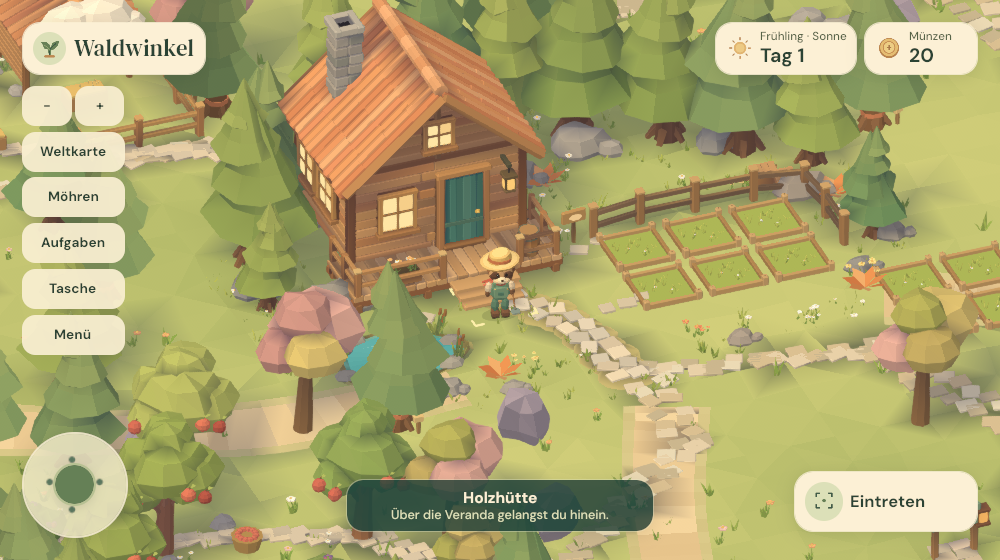

# Waldwinkel

Ein Cozy-3D-Spiel aus Bevy und Rust. Der Hof und sechs Ausflugsgebiete liegen in einer zusammenhängenden Landschaft. Wege und Brücken verbinden Farnwald, Muschelbucht, Eichenhafen, Kupferklamm, Windweiden und Nebelmoor. Der Tanuki, die neun Figuren und die 3D-Modelle stammen aus dem beigefügten Blender-Projekt.



## Installieren

- Lade die signierte APK herunter und öffne sie auf deinem Android-Gerät unter **Downloads**. [Android-APK](https://github.com/bthginfo/waldwinkel/releases/latest/download/Waldwinkel-Android.apk) · [Alle Versionen](https://github.com/bthginfo/waldwinkel/releases)
- Voraussetzungen sind Android 8 oder neuer, Vulkan und ein 64-Bit-System (ARM64 oder x86-64). Das Spiel läuft offline. Installiere das Update über die bisherige Version, damit deine Spielstände erhalten bleiben.

## Neu in 0.9.0

- **Kupferklamm.** Nach einem Stadtauftrag kannst du am östlichen Steg den Weg freischalten. Runa erzählt dir an der Schmiede von der Klamm. An den hellen Felswänden findest du Quarz.
- **Windweiden.** Nach zwei Stadtaufträgen bittet dich die Wache am südlichen Pfad um Baumaterial und Wolle. Nele hat an der Mühle Aufträge für dich. Auf den Wiesen wächst Flachs.
- **Nebelmoor.** Nach drei Stadtaufträgen kannst du den westlichen Moorweg mit Klammquarz und Holz wieder öffnen. Folge den Stegen zur Kräuterkundigen Edda und sammle Nebelminze.
- **Schnellreise.** Jede der sieben Wegglocken hat einen eigenen Reparaturauftrag. An einer fertigen Glocke kannst du eine andere bereits reparierte Glocke als Ziel wählen. Über die Weltkarte kannst du die Regionen zu Fuß ansteuern.

[Kupferklamm](docs/kupferklamm.png) · [Windweiden](docs/windweiden.png) · [Nebelmoor](docs/nebelmoor.png) · [Weltkarte](docs/weltkarte.png)

## Seit 0.8.0

- **Tierhaltung am Hof.** Baue am markierten Platz einen Hühnerstall oder eine Schafscheune. Danach kannst du ein Tier aufnehmen, füttern und streicheln. Gut versorgte Tiere liefern Eier oder Wolle. Zutrauen erhöht den Ertrag.
- **Einrichten.** An der Werkbank gibt es 18 Möbel. Kaufe Baupläne am Markt, finde sie unterwegs oder verdiene sie mit Stadtaufträgen. Sobald das Möbel gebaut ist, wähle es über **Einrichten** und tippe auf einen freien Platz in der Hütte.
- **Hofküche.** Sechs Rezepte nutzen Gemüse, Obst, Pilze, Nüsse und Eier. Beim Kochen triffst du mit dem Rühren den grünen Bereich. Beim Einmachen gibst du Zutaten in der angezeigten Reihenfolge hinzu. Für die Handmühle wechselst du zwischen links und rechts. Fertige Speisen und Mehl können in die Verkaufstruhe.
- **Nachwachsende Kiefern.** Fällbare Kiefern wachsen nach drei Spieltagen nach.

[Hofküche im Spiel](docs/hofkueche.png) · [Hühnerstall](docs/huehnerstall.png)

## Seit 0.7.0

- **Tagesablauf.** Der Tag beginnt um 06:00. Eine reale Sekunde entspricht einer Spielminute. Ab 19:00 wird es dämmrig, der Markt schließt um 20:00. Ab 22:00 ruhen Feldarbeit, Fischfang, Holz- und Erzabbau. Du kannst weiterlaufen, nach Hause gehen und in der Verkaufstruhe verkaufen. Schlafen im Bett beginnt den nächsten Tag.
- **Anbau.** Tippe auf ein Beet und dann auf seine Aktion. Der Tanuki geht selbst in Reichweite und legt das Beet an, sät, gießt oder erntet. Über **Saatgut** wählst du direkt zwischen sechs Kulturen. Ein eigenes Symbol und die Gießkanne zeigen, wann ein Beet Wasser braucht.
- **Saatgut und Qualität.** Samen gibt es beim Saatgutstand, in Farnwald und Muschelbucht, als Auftragsbelohnung und bei 30 % der Ernten. Gedüngte Beete liefern bei der nächsten Ernte feine oder prächtige Ware. Ein Pack mit zwei Einheiten Dünger kostet am Saatgutstand vier Münzen.
- **Verkaufstruhe.** Öffne die Holzkiste neben dem Hofweg und wähle Ware und Qualität. Du kannst ein Stück oder den ausgewählten Stapel direkt verkaufen.

[Saatguttasche im Android-Spiel](docs/saatguttasche.png) · [Weltkarte](docs/weltkarte.png)

## Seit 0.6.0

- **Haus.** Tippe das Dach, die Fassade oder die Veranda an und drücke **Eintreten**. Der Tanuki läuft zur Tür. Drinnen findest du **Hinausgehen** an der Treppe.
- **Bewegung.** Das Lauftempo ist um 40 % gestiegen. Der Touch-Stick erlaubt langsames Gehen mit kurzem Ausschlag. Beim Anlaufen, Drehen und Bremsen geht der Tanuki fließend in die nächste Bewegung über. Häuser, Zäune, Baumstämme, Felsen und Möbel blockieren den Weg.
- **Axt und Spitzhacke.** Markierte Kiefern, große Steinblöcke und Erzadern zeigen die passende Aktion. Einmal drücken genügt. Der Tanuki sucht eine Stelle neben dem Ziel, benutzt sein Werkzeug und legt die Ausbeute in die Tasche. Zwei fällbare Kiefern und ein zusätzlicher Steinblock liegen jetzt näher am Hof.

[Innenansicht der Holzhütte](docs/holzhuette.png) · [Weltkarte](docs/weltkarte.png)

## Spielstände

Im Startmenü kannst du auf bis zu drei getrennten Plätzen ein **Neues Spiel** beginnen oder mit **Fortsetzen** in einen vorhandenen Hof zurückkehren. Speicherdaten liegen lokal auf dem Gerät. Anbau, Sammelfunde, Handel und Aufträge werden bei der Aktion gespeichert. Der Aufenthaltsort wird beim Wechsel zwischen Innen- und Außenbereichen, beim Erreichen eines neuen Landschaftsbereichs und nach Bewegung automatisch gespeichert.

Über **Menü → Jetzt speichern** kannst du den aktuellen Aufenthaltsort und Fortschritt sofort speichern. **Speichern & Hauptmenü** führt zurück zur Spielstandauswahl.

## Spielabläufe

| Ort | So funktioniert es |
| :-- | :-- |
| Außenwelt | Links ist der Touch-Stick. Pinch oder **−/+** ändert die Zoomstufe. Auf der **Weltkarte** siehst du die zusammenhängende Landschaft. |
| Wege | Laufe selbst oder tippe auf begehbaren Boden. Ziele auf der **Weltkarte** kannst du direkt anwählen. Mit dem Stick kannst du unterwegs übernehmen. |
| Farnwald | Sammle Pilze und Haselnüsse auf beiden Seiten des Baches. Drei Holzbrücken verbinden die Ufer. Weitere Sammelstellen liegen an den Lichtungen und Fernwegen. |
| Muschelbucht | Suche am Strand und hinter den Dünen nach Muscheln und Treibholz. Sammelstellen im Farnwald und an der Bucht füllen sich nach zwei Spieltagen wieder. |
| Eichenhafen | Tippe auf eine Figur und dann auf **Ansprechen**. Lina verkauft Saatgut und Miro kauft Erzeugnisse und Funde. Mara, Fiete und Bo geben Aufträge. Juna erzählt dir, wohin die Wege führen. |
| Aufträge | Nimm Aufträge im Gespräch an und kehre mit den geforderten Zutaten und Materialien zurück. Das Journal zeigt den Stand der Stadtaufträge und der drei regionalen Questketten. |
| Garten | Möhren, Rüben, Kürbisse, Erdbeeren, Tomaten und Sonnenblumen brauchen zwei bis fünf gegossene Tage. Eine Düngergabe vor der Reife reicht für die nächste Ernte. |
| Kalender | Uhrzeit und Wetter stehen oben im HUD. Schlafen im Bett setzt die Uhr auf 06:00 und lässt gegossene Pflanzen wachsen. Regen gießt Pflanzen und neue Saat automatisch. Eine Jahreszeit dauert sieben Tage. |
| Obstwiese | Äpfel und Waldbeeren pflücken. Jeder abgeerntete Baum oder Strauch trägt nach zwei Spieltagen wieder Früchte. |
| Hafenmarkt | Beim Saatgutstand jeweils drei Samen der gewählten Sorte kaufen. Beim Ankäufer wechselt die linke Auswahltaste zwischen den verfügbaren Waren. Obst, Gemüse, Fisch, Eier, Wolle, Silber und Kristalle bringen Münzen. |
| Tiere | Baue das passende Gebäude am Hof und nimm ein Tier auf. Pflege und Ernte erfolgen am eigenen Stall. Futter kannst du an der Futterkiste auf der Tierweide nachkaufen. |
| Mine | Kupfer und Silber liegen in den ersten Ebenen. Ab Tiefe 3 kommen Kristallnester und dunkles Gestein hinzu. Die Hafenschmiede kann die Spitzhacke für zwei Kupfer, zwei Holz und zwölf Münzen verbessern. Die verbesserte Hacke liefert zwei Erze pro Ader. |
| Aufgaben | Am Brett oder links über **Aufgaben** öffnen. Die acht Aufgaben fördern Garten, Sammeln, Handel, Tiere und Mine. Für eine erfüllte Aufgabe gibt es Saatgut und Münzen. |
| Haus, Wald und Steg | Möbel herstellen und versetzen, markierte Kiefern fällen, Stein abbauen und am Steg angeln. |

Am Rechner funktionieren auch WASD oder Pfeiltasten, Tab zum Beetwechsel, Leertaste für die Aktion, Mausrad zum Zoomen, M für die Weltkarte, E für die Saatguttasche oder die Auswahl am Markt, F zum Düngen, Q für Aufgaben und I für die Tasche. Escape öffnet das Pausenmenü oder schließt ein Fenster. F10 blendet das HUD aus, F12 speichert ein Spielbild.

## Projekt ausführen und bauen

```sh
cargo run --release --locked
cargo test --release --locked --lib
```

Für die Android-APK werden JDK 17 oder neuer, Android SDK Platform 36, Build Tools 36.0.0, NDK r28c, Python 3 und die Rust-Ziele für beide ABIs benötigt. `ANDROID_HOME` zeigt auf den SDK-Ordner. Optional zeigt `ANDROID_NDK_HOME` auf eine abweichende NDK-Installation.

```sh
rustup target add aarch64-linux-android x86_64-linux-android
tools/build-android.sh
```

Das Skript schreibt die APK nach `build/android`. NativeActivity startet das Rust-Spiel. Die kleine Android-Activity setzt die Systemleisten auf Vollbild.

## Blender und Weiterentwicklung

- `art/Waldwinkel.blend` enthält die Modelle und eine Gesamtansicht der Landschaft. `blender -b -P art/build_scene.py` exportiert die Modelle als GLB und erzeugt das Höhenfeld für Ufer, Brücken und Hindernisse. Bevy animiert Beine, Schuhe, Arme und den Schweif des Tanuki über getrennte Drehpunkte.
- `art/draw_icons.py` zeichnet die HUD-Symbole und das App-Icon. Die verwendeten Schriften sind DM Sans und DM Serif Text mit beigefügter OFL-Lizenz.
- Bewegung, Beetauswahl und Aktionen laufen im Spiel über gemeinsame Eingaben. Für Controller kann dort eine weitere Eingabequelle angeschlossen werden.
- Blender liefert die Regen- und Schneemodelle. Bevy animiert den Niederschlag, färbt die Außenansicht nach Wetter und Jahreszeit und zeigt gegossenen Boden.

## Über Find Skills geprüft

- **Bevy ECS** für Komponenten, Ressourcen, Systemreihenfolge und Tests. Die API-Beispiele wurden auf die im Projekt gepinnte Bevy-Version bezogen. [bevy-ecs](https://skills.sh/gamedev-skills/awesome-gamedev-agent-skills/bevy-ecs)
- **Blender Modeling, Animation und Export** für modellierte Kanten, Drehpunkte und die Prüfung des GLB-Exports. [Modeling](https://skills.sh/roble3/cc-blender-skill/blender-modeling), [Animation](https://skills.sh/roble3/cc-blender-skill/blender-animation), [Export](https://skills.sh/roble3/cc-blender-skill/blender-export)
- **Blender Motion State Inspection** und **Character Rigging** für Achsen, Gelenkpunkte und Fußkontakt. **Blender Weather FX** ist eine Referenz für spätere Wetter-Looks und Oberflächenmasken. [Motion State Inspection](https://skills.sh/affaan-m/ecc/blender-motion-state-inspection), [Character Rigging](https://skills.sh/el4cteo/blender-skills/blender-character-rigging), [Weather FX](https://skills.sh/el4cteo/blender-skills/blender-weather-fx)

## Tests und nächste Etappen

33 Rust-Tests decken unter anderem Tageswechsel, Erntequalität, Tierpflege, Möbelbau, Küchenminispiele, passierbare Regionalwege und Wegglocken sowie die Übernahme alter Spielstände ab. Die Android-Builds werden im Android-14-Emulator über die vorherige Installation geprüft. Die Aufnahmen stammen aus dem laufenden Bevy-Spiel.

Die Blender-Landschaften entstanden nach eigenen Bildreferenzen. [Kupferklamm](art/references/kupferklamm.png) · [Windweiden](art/references/windweiden.png) · [Nebelmoor](art/references/nebelmoor.png)

**Nächste Etappe – Kartenkämpfe.** Prozedurale Ebenen mit ansteigender Schwierigkeit und Rückkehr zu freigeschalteten Ruheplätzen. Karten kommen aus Erkundung, Aufträgen, Handel und Kämpfen. Ein Deck umfasst zwölf Karten und wird am Kartenbinder daheim zusammengestellt. Kampftalente verbessern Gesundheit und Widerstand. [Bildreferenz für die Dämmergänge](art/references/daemmergaenge.png)
